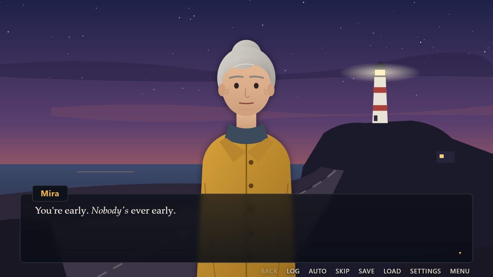

# Emaki

*Unroll your story. Write like a screenplay, ship everywhere.*

An open-source (MIT) visual novel engine. Write your story in a plain-text script, edit it with the game running beside it, translate it, and ship it to the web, Windows, macOS, Linux (with Steam achievements) and phones.



> **Emaki** (絵巻, *eh-MAH-kee*) are Japanese illustrated handscrolls, pictures and words read scene by scene as the scroll unrolls. They're one of the oldest ancestors of the visual novel.

```
label arrival:
  scene cliff_road with fade
  show mira neutral at center with dissolve
  mira: You're early. *Nobody's* ever early.

  menu:
    "I wanted to see the light come on.":
      set trust += 1
      mira smile: Did you now.
    "The driver wanted to beat the storm.":
      mira: Smart man.
```

## Start here

You need Node.js 22.18 or newer.

```sh
git clone https://github.com/AbhishekNair050/Emaki.git
cd Emaki
npm install
npm run launch                       # open the project launcher
npm run dev                          # play the demo, The Keeper of Gullwing Point
npm run emaki -- new ../my-game      # start your own game
```

**[Getting started](docs/getting-started.md)** takes you from there to your own game playing in the browser.

## What it does

**Writing**
- A script that reads like a screenplay: dialogue, choices, conditions, variables, scenes split across files, and comments anywhere. Errors come with line numbers and a suggested fix, written for writers rather than programmers.
- Backgrounds, characters and their expressions, layered characters (outfits × faces), side portraits, transitions, character moves, camera zoom, shake and flash, colour tones, movies.
- Music with fades and crossfades, ambience loops, sound effects, and voice acting by convention (one header line; no `play voice` on every line).
- Text styling (bold, italic, colour, ruby/furigana), pauses inside a line, full-screen text (NVL mode).

**Looking like your game**
- Your own title screen, text box, menus, save and load pages, settings, backlog and dialogs, written as `screen` blocks in the script and styled with `theme.css`. Picture buttons with hover, pressed and selected art line up pixel for pixel with UI drawn at a fixed size.
- Extras: a CG gallery, scene replay, a music room, endings and achievements, unlocked by playing.

**For players**
- Saves with thumbnails, quick save, rollback to any earlier line, a backlog with voice replay, auto and skip (read text only, or everything), skipping to the next choice.
- Keyboard, mouse, touch and gamepad. Screen-reader friendly, with reduced motion respected and a choice of reading fonts (including Atkinson Hyperlegible and OpenDyslexic).
- Plays on phones, upright or sideways.

**Tools**
- **The launcher** (`npm run launch`): create or open a game, see each project's picture, size and problems at a glance, open the editor in the workspace you want, play, and export for the web, desktop, Android or iOS. Includes a folder browser; no environment variables needed.
- **The editor** (`npm run edit`): the script, the game and a flowchart of the story side by side. Type and the game updates in place; Ctrl+Enter plays from the cursor; shape the story in the flowchart; drag assets in.
- **VS Code extension**: highlighting, errors as you type, completion, go to definition, hover, formatting, and "play from this line".
- **Story map and line preview** while developing: see every scene, jump anywhere, set variables to test other routes, or open the game at any line (`?line=52&trust=2`).
- **CLI**: `emaki new`, `check`, `fmt` (keeps your comments), `graph`, `strings` (translation files), `voices` (recording script), `export`.

**Shipping**
- One command for each target: a website for itch.io, a Windows x64 player with WebView2 and an encrypted game pack, desktop apps with Electron and Steam achievements, and Android and iOS projects (Capacitor). See [Exporting](docs/exporting.md).
- Translations as PO files or spreadsheets, with pictures and movies per language. Players switch language in Settings, and changed lines come back marked for review.
- **Plugins** for what the script doesn't do: your own JavaScript commands, screen elements and functions (`@weather start kind="snow"`, `if @dice.roll(6) > 4:`), checked by the compiler. Plugins can change the variables they declare and keep their own data; `emaki plugin` starts one, typed for JavaScript or TypeScript. See [Plugins](docs/plugins.md).

## Documentation
- **[Getting started](docs/getting-started.md)**: your first game, step by step
- **[Script syntax](docs/script-syntax.md)**: everything you can write in a story
- **[Writing tools](docs/tools.md)**: the editor, VS Code, the dev server, story map, line previews and the CLI
- **[Theming](docs/theming.md)**: title screen, your own screens, `theme.css`
- **[Plugins](docs/plugins.md)**: extending Emaki with JavaScript
- **[Exporting](docs/exporting.md)**: web, desktop, Steam, Android and iOS
- **[Story format](docs/story-format.md)**: the compiled JSON any runtime can play
- **[Decisions](docs/decisions.md)**: why things are the way they are
- **[Roadmap](docs/roadmap.md)**: what's done and what's next
- **[Changelog](CHANGELOG.md)**: what changed, version by version

## Status and known limitations
Emaki is young (0.x). It's been used to write the demo and to port two complete existing visual novels, but expect rough edges:

- The script language and the compiled format may still change before 1.0. Changes are logged in [Decisions](docs/decisions.md).
- Nothing is published yet: run Emaki from this repository, and install the VS Code extension [from source](packages/vscode/README.md#install-from-source).
- Desktop export is tested on Windows. macOS and Linux apps are built the same way but haven't been tried on those systems yet, and macOS apps need signing before others can open them without warnings.
- Steam support (achievements, overlay) and the Android APK build are written but not yet tested against real Steam or on a device. iOS projects need a Mac to build.
- Not yet: Live2D or Spine characters, plural forms in translations, a Ren'Py importer.

Found a bug, or something you need for your game? [Open an issue](https://github.com/AbhishekNair050/Emaki/issues).

## Repository

| Package | |
|---|---|
| `@emaki/format` | parser, compiler, expressions, printer, story graph (no dependencies) |
| `@emaki/runtime` | headless story engine: rollback, saves, live-reload resume |
| `@emaki/player-web` | browser player (DOM, accessible, phone-friendly, about 40 KB gzipped) |
| `@emaki/editor` | the web editor (`npm run edit`) |
| `@emaki/language` | editor features over plain text, shared by the editor and the VS Code extension |
| `@emaki/cli` | `new`, `check`, `build`, `graph`, `fmt`, `strings`, `voices`, `export` |
| `@emaki/desktop` | Windows WebView2 player, encrypted game packs, Electron and Steamworks export |
| `@emaki/mobile` | Android and iOS export (Capacitor) |
| [`emaki-vscode`](packages/vscode) | the VS Code extension |

Example games: [`games/gullwing`](games/gullwing), *The Keeper of Gullwing Point*, a short original story with three endings (hand-coded SVG art by `tools/gen-art.mjs`; CC0 music and sounds, credited in [`CREDITS.md`](games/gullwing/assets/audio/CREDITS.md)), and [`games/plugin-demo`](games/plugin-demo), a small game using three example plugins.

Want to help? See [CONTRIBUTING.md](CONTRIBUTING.md).

## License
MIT. Games you make with Emaki are yours, under any license you choose.
